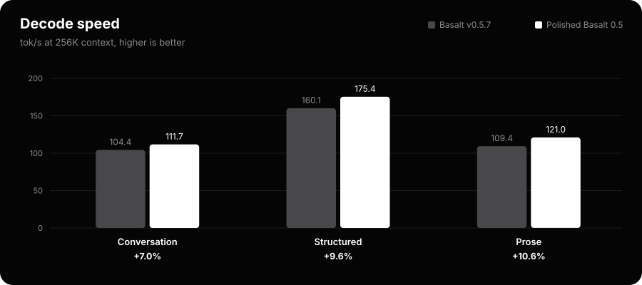
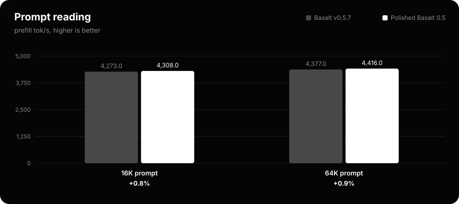

# Polished Basalt 0.5

A personal [Basalt](https://github.com/jesdga95/basalt) fork tuned for one RTX 5080 (16 GB, 250 W), a Ryzen 7 9800X3D and 128 GB RAM on native Windows, serving Qwen 3.8 Flash-Next with a 262,144-token window. Basalt descends from [Strata](https://github.com/Niko1221/Strata); both projects keep their credits and licences.

Built on upstream `main` (`d0f35a8f`, 157 commits ahead of `v0.5.7`).

| RTX 5080 · 250 W · 256K · seed 5080 | Basalt v0.5.7 | Polished Basalt 0.5 | Change |
| --- | ---: | ---: | ---: |
| Decode, conversation | 104.4 tok/s | **111.7 tok/s** | **+7.0%** |
| Decode, structured output | 160.1 tok/s | **175.4 tok/s** | **+9.6%** |
| Decode, prose | 109.4 tok/s | **121.0 tok/s** | **+10.6%** |
| Prefill, 16K prompt | 4,273 tok/s | **4,308 tok/s** | +0.8% |
| Prefill, 64K prompt | 4,377 tok/s | **4,416 tok/s** | +0.9% |
| Load to ready | 37 s | **33 s** | −4 s |

Same seeded fixtures for both columns. The experts stay lossless int8; a q4_0 arm was slower and lossy, so it was rejected. [Data and method](benchmarks/rtx5080/results.json)

## What changed

- WDDM-aware free-VRAM reading through NVML (upstream PR #822), so the expert budget matches what Windows really leaves free.
- AVX-512 VNNI Q5_1 down-projection on the CPU, with a parity test across 1 to 8 threads.
- Staged PCIe miss split sized from the probed link rate, and a warm-up of the top-3 L3 experts.
- Windows EcoQoS opt-out and locked working-set tracking, so the CPU workers are not throttled.
- A fix for the warm-up state (`CpuWarm::blobs`, `n_blobs`) that was not reset between runs.
- Tuned defaults for this machine: batch 1, prefill CPU share 0.45 (measured +9% prefill over 0.60), 7 workers, 384 MiB reserve, 8 speculative tokens.

## Run it

Build and launch as described in the [upstream README](UPSTREAM_README.md), then use the measured settings for this machine: batch 1, int8 experts, `--prefill-cpu-share 0.45`, 7 CPU workers, a 384 MiB VRAM reserve and 8 speculative tokens. Run `basalt-probe` first on a different PC; it suggests the prefill CPU share for that hardware.
